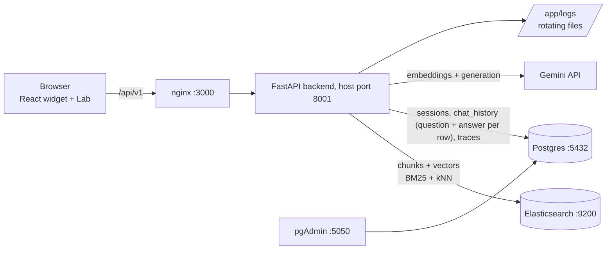

# DocuMind RAG

A full-stack **Retrieval-Augmented Generation** app built to *teach* RAG. Everything the system does - chunking, keyword search (BM25), embeddings, Reciprocal Rank Fusion, prompt building - is visible in the UI, explained in `docs/`, and commented in the code.

> **Sample topic:** Space Exploration (Apollo, Voyager, Mars rovers, Webb, Hubble, ISS, Artemis, exoplanets...). 10 short original documents in [`sample_corpus/`](sample_corpus), chosen because they contain both *exact-name* questions (BM25 wins) and *paraphrase* questions (embeddings win).

## What you get

| Piece | Tech | Role |
|---|---|---|
| `frontend` | React + TypeScript + Tailwind, served by nginx | Floating chat widget, upload, **RAG Lab** page |
| `backend` | Python 3.12, FastAPI | Router -> Service -> Repository; RAG pipeline; security; rotating logs |
| `elasticsearch` | 8.15 | Chunk text (BM25) + `dense_vector` embeddings (kNN) |
| `postgres` + `pgadmin` | 16 / 8 | Sessions and chat history (with the full retrieval trace of every answer) |
| Gemini API | `gemini-embedding-001`, `gemini-3.5-flash` | Embeddings and answer generation |

## Learn RAG with it - suggested path

1. Start the stack (below), open the chat bubble, **📎 -> Load sample corpus**.
2. Ask *"Which robot flew a small aircraft on another planet?"* then click **How did I answer?** and flip through the BM25 / Vector / RRF / Prompt tabs.
3. Open the **RAG Lab** (`/lab`) and use the four example buttons. Slide *RRF k*. Open *Why this BM25 score?*. Plot the *Embedding map*.
4. Read the docs in order, each ends with something to try:

| Doc | Topic |
|---|---|
| [01 RAG overview](docs/01-rag-overview.md) | The whole pipeline, why RAG, where it breaks |
| [02 Chunking](docs/02-chunking.md) | Size/overlap trade-offs, recursive splitting |
| [03 Embeddings](docs/03-embeddings.md) | Vectors, cosine similarity, task types, Matryoshka, HNSW |
| [04 TF-IDF & BM25](docs/04-tfidf-bm25.md) | Inverted index, IDF, saturation `k1`, length norm `b`, with numbers |
| [05 Hybrid search & RRF](docs/05-hybrid-search-rrf.md) | Why combine, how RRF works, the role of `k` |
| [06 Grounded prompting](docs/06-grounded-prompting.md) | Prompt anatomy, query rewriting, prompt injection |
| [07 Evaluation](docs/07-evaluation.md) | Hit@k, MRR, running `scripts.evaluate`, its limits |

5. Run the numbers: `docker compose exec backend python -m scripts.evaluate` compares BM25-only, vector-only and hybrid on 25 labelled questions.
6. Run the from-scratch implementation: `docker compose exec backend python -m app.services.retrieval.tfidf_demo`.

## Architecture



```
backend/app
├─ api/v1/        health.py documents.py chat.py lab.py     <- routers (HTTP only)
├─ services/      ingestion rag llm embeddings chunking parsing
│  └─ retrieval/  hybrid.py rrf.py explain.py tfidf_demo.py <- the interesting part
├─ repositories/  es_repo.py pg_repo.py models.py           <- the only code that talks to databases
└─ core/          security.py logging_config.py             <- session tokens, upload validation, log rotation
```

## Prerequisites

- **Docker Desktop** (Windows/macOS) or Docker Engine + Compose v2. Allow it ~3 GB RAM (Elasticsearch uses 512 MB heap).
- A free **Gemini API key**: <https://aistudio.google.com/apikey>.
- Free ports: `3000`, `8001`, `5050`, `5432`, `9200`.

## Setup

```bash
cp .env.example .env            # Windows PowerShell:  copy .env.example .env
# edit .env: set GEMINI_API_KEY and SESSION_SECRET
docker compose up --build
```

First start takes a few minutes (image pulls). When it settles:

| URL | What |
|---|---|
| <http://localhost:3000> | The app (widget on every page, `/lab` for the Lab) |
| <http://localhost:8001/docs> | Swagger UI for the API |
| <http://localhost:5050> | pgAdmin (login from `.env`; add server host `postgres`, user/password from `.env`) |
| <http://localhost:9200/chunks/_count> | Elasticsearch chunk count |

Optional: preload the corpus from the terminal instead of the UI:
`docker compose exec backend python -m scripts.seed_corpus`

Stop with `Ctrl+C`; `docker compose down -v` also deletes all data volumes.

### Environment variables

See [`.env.example`](.env.example) - every variable is documented there. The important ones: `GEMINI_API_KEY`, `GEMINI_EMBEDDING_MODEL`, `GEMINI_LLM_MODEL`, `EMBEDDING_DIMENSIONS`, `SESSION_SECRET`, and the RAG knobs `CHUNK_SIZE`, `CHUNK_OVERLAP`, `RETRIEVE_K`, `TOP_K`, `RRF_K`.

> Changing the embedding model or `EMBEDDING_DIMENSIONS` requires a new index: `docker compose down -v` (or delete the `chunks` index) and re-load documents.

## API

All paths are under `/api/v1`. Protected endpoints need headers `X-Session-Id` and `X-Session-Token` (from `POST /chat/session`).

| Method | Path | Auth | Purpose |
|---|---|---|---|
| GET | `/health` | no | Backend, ES, Postgres status, chunk count, models |
| POST | `/chat/session` | no | Create session -> `{session_id, token}` |
| POST | `/documents/upload` | yes | PDF/TXT/DOCX -> parse -> chunk -> embed -> index |
| GET | `/documents` / DELETE `/documents/{id}` | yes | List / remove indexed documents |
| POST | `/chat/message` | yes | Full RAG turn -> `answer`, `sources`, `trace` |
| GET | `/chat/history?session_id=` | yes | Messages of your session |
| POST | `/chat/reset` | yes | Archive session, return a new one |
| POST | `/lab/search` | yes | BM25 vs vector vs RRF side by side (`explain`, `rrf_k`) |
| GET | `/lab/embedding-map?q=` | yes | PCA 2-D projection of chunks (+ query) |
| POST | `/lab/seed`, DELETE `/lab/corpus` | yes | Load sample corpus / clear index |

### Postman

1. Postman -> **Import** -> [`Postman_Collection.json`](Postman_Collection.json).
2. The `baseUrl` variable defaults to `http://localhost:8001/api/v1`.
3. Run requests **1 -> 11 in order** (or use the Collection Runner). *Create session* stores `session_id`/`session_token`; *Reset* swaps them for the new session. In *Upload document* pick a file in the `file` field. Request 12 shows a forged token being rejected.

## Security notes

- **Sessions:** server-issued UUID + `HMAC-SHA256(SESSION_SECRET, id)` token. Forging a token for someone else's id is infeasible; compared in constant time. This is capability-style access, **not** user login - add real authentication before exposing it.
- **Uploads:** extension allow-list, 10 MB cap, magic-byte check (PDF `%PDF-`, DOCX zip structure, TXT UTF-8 and no NULs), sanitized filenames (no path traversal).
- **Input:** Pydantic length limits, Unicode normalisation, control characters stripped; SQL via SQLAlchemy parameters; output rendered as Markdown without raw HTML.
- **CORS:** explicit origin allow-list (`CORS_ORIGINS`). In Docker the browser talks only to nginx, so no cross-origin calls happen at all.
- **Prompt injection:** see [docs/06](docs/06-grounded-prompting.md).
- **Dev-only shortcuts:** Elasticsearch security is off and ports are published; the default `SESSION_SECRET` logs a warning. Do not deploy as-is.
- **Logging:** `RotatingFileHandler`, 5 MB x 5 files in the `backend_logs` volume (`/app/logs/app.log`) - worst case 30 MB. Read it with `docker compose exec backend tail -f logs/app.log`.

## Tests

```bash
docker compose run --rm backend python -m pytest -q
```

Covers chunking, RRF (including the worked example from the docs), BM25/TF-IDF formulas by hand, the ES `explain` parser, upload/session security, and the API flow with Elasticsearch/Postgres/Gemini faked. Retrieval *quality* is measured separately by `scripts.evaluate` against the real stack.

Frontend: `cd frontend && npm install && npm run build` (type-checks with strict TypeScript). Hot-reload dev server: `npm run dev` (proxies `/api` to `localhost:8001`).

## Differences from the original spec (and why)

| Spec | Here | Reason |
|---|---|---|
| `text-embedding-004`, `gemini-1.5-flash` | `gemini-embedding-001` (768-d), `gemini-3.5-flash`, both configurable | Google retires model names regularly; check the Gemini docs if a model returns 404 |
| (not mentioned) RRF via Elasticsearch | RRF written in Python | ES's native RRF retriever needs a paid licence, and our version exposes every rank for teaching |
| Session via header *or* cookie | Header (`X-Session-Id` + HMAC token) | Simple, CORS-friendly, easy to test in Postman |
| DOCX in the first list, PDF/TXT in the prompt | PDF, TXT **and** DOCX | Harmless superset |
| (added) | RAG Lab, traces, evaluation script, 7 docs, follow-up query rewriting | The point of the project is learning |

## Troubleshooting

- **Elasticsearch container exits:** give Docker more memory; on Linux hosts run `sudo sysctl -w vm.max_map_count=262144`.
- **Backend log says GEMINI_API_KEY is empty / chat answers `502`:** set the key in `.env`, then `docker compose up -d --force-recreate backend`.
- **`429` / retries in logs:** free-tier Gemini rate limit; the embedder backs off and retries (up to 5 times). Loading the corpus is ~40 chunks in 1 batch.
- **Model not found (404):** update `GEMINI_EMBEDDING_MODEL` / `GEMINI_LLM_MODEL`.
- **Port already allocated:** change the left side of the `ports:` mapping in `docker-compose.yml`.
- **Scanned PDF "no extractable text":** needs OCR; not supported.

## Ideas to go further

Cross-encoder re-ranking after RRF - metadata filters - heading-aware chunking - streaming answers - answer-faithfulness evaluation with an LLM judge - per-user document ownership.
