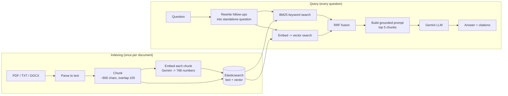

# 01 - RAG in one page

**RAG = Retrieval-Augmented Generation.** Instead of asking an LLM to answer from memory, you first *retrieve* the relevant passages from your own documents, paste them into the prompt, and let the LLM *generate* an answer from them.

## Why not just ask the LLM?

| Problem with a bare LLM | How RAG helps |
|---|---|
| It does not know your private documents | Your documents are the retrieval source |
| Its knowledge is frozen at training time | Re-index new documents in seconds; no retraining |
| It hallucinates confident nonsense | The prompt says "answer only from the context, else say you don't know" |
| You cannot verify its claims | Answers cite `[1] [2]` that point to real chunks |

**Why not paste all documents into the prompt?** Long-context models can take a lot of text, but every token costs money and latency, and models get *worse* at finding a needle in a huge haystack. Retrieval narrows 100 pages down to the 5 chunks that matter.

**Why not fine-tune?** Fine-tuning teaches *style and skills*, not reliable *facts*, and you cannot cite it or update it cheaply.

## The two phases

Every box above is a file you can read:

| Step | File |
|---|---|
| Parse | `backend/app/services/parsing.py` |
| Chunk | `backend/app/services/chunking.py` |
| Embed | `backend/app/services/embeddings.py` |
| Index / BM25 / kNN | `backend/app/repositories/es_repo.py` |
| Hybrid retrieval | `backend/app/services/retrieval/hybrid.py` |
| RRF | `backend/app/services/retrieval/rrf.py` |
| Prompt + LLM | `backend/app/services/llm.py` |
| The whole loop | `backend/app/services/rag.py` |

## Where RAG goes wrong (and which doc covers it)

Most "bad RAG answers" are **retrieval** failures, not LLM failures. If the right chunk never reaches the prompt, no LLM can save you. So debug in this order:

1. Was the answer in the documents at all? (parsing: scanned PDFs have no text!)
2. Was it cut in half by chunking? -> [02 Chunking](02-chunking.md)
3. Did the retriever find it? -> [03 Embeddings](03-embeddings.md), [04 TF-IDF & BM25](04-tfidf-bm25.md), [05 Hybrid & RRF](05-hybrid-search-rrf.md)
4. Did the LLM use it correctly? -> [06 Grounded prompting](06-grounded-prompting.md)
5. How do you *know* it got better? -> [07 Evaluation](07-evaluation.md)

## Glossary

- **Chunk** - a small piece of a document (a few paragraphs) that is indexed and retrieved as a unit.
- **Embedding** - a list of numbers representing the meaning of a text.
- **Vector search / kNN** - find the stored vectors nearest to the query vector.
- **BM25** - the standard keyword-relevance formula (successor of TF-IDF).
- **Hybrid search** - run keyword and vector search, then combine.
- **RRF** - Reciprocal Rank Fusion, a way of combining ranked lists.
- **Grounding** - constraining the LLM to answer from supplied context.
- **Top-k** - how many results you keep.

## Try it in the Lab
Open <http://localhost:3000/lab>, click **Exact name** and then **Paraphrase**. Notice that the BM25 and Vector columns disagree - the rest of these docs explain why that is a feature.
